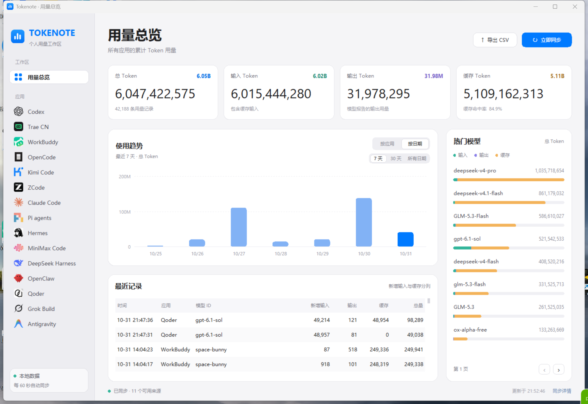

# Tokenote

Windows Agent 用量桌面客户端，读取本机日志，集中查看 Token 用量、模型分布和使用趋势。

## 下载使用

前往 [GitHub Releases](https://github.com/kgdqqfge/tokenote/releases) 下载 **Tokenote.exe**，双击即可运行，无需安装 Python 或从源码打包。

- 系统要求：Windows 10/11 x64。
- 首次运行时确认使用提示，即可进入主界面。
- 数据保存在 `%LOCALAPPDATA%\Tokenote\tokenote.db`。

## 产品界面



集中展示 Token 用量、使用趋势、热门模型和最近记录。

## 源码运行

需要 Python 3.10 及以上版本，推荐 Python 3.14，使用 Windows 官方 Python 安装包附带的 Tkinter。

```powershell
cd <项目目录>
python -m pip install -r requirements.txt
python app.py
```

也可双击 `run.bat` 启动。仅同步一次：

```powershell
python app.py --sync-only
```

同一统计库只运行一个实例，再次启动会唤起已有窗口。数据目录可通过 `TOKENOTE_DATA_DIR` 指定。

## 数据源

已接入 Codex、Trae CN、WorkBuddy、OpenCode、Kimi Code、DeepSeek Harness、OpenClaw（含 AutoClaw）、Qoder、Grok Build、ZCode、Claude Code、Pi agents、Hermes、MiniMax Code、Antigravity。

- **Antigravity**：读取 `~/.gemini/antigravity/conversations/*.db`，并兼容 `antigravity-ide`、`antigravity-cli` 目录。按每次模型生成统计新增输入、缓存读取、输出和思考 Token，并从 `gen_metadata` 还原实际使用的模型。路径可通过 `TOKENOTE_ANTIGRAVITY_DIR` 或 `ANTIGRAVITY_HOME` 指定。

- **DeepSeek Harness**：读取 `~/.dsh/sessions/**/session.jsonl.zstd` 或 `session.jsonl`，桌面端使用带版本号的文件名（如 `session.v4.jsonl.zstd`）同样支持。支持逐请求、模型切换和缓存占比统计。路径可通过 `DSH_HOME` 或 `TOKENOTE_DEEPSEEK_HARNESS_DIR` 指定。
- **OpenClaw**：读取 `~/.openclaw/agents/*/sessions/*.jsonl` 及 `.openclaw-*` profile（例如 `.openclaw-autoclaw`）。状态目录可通过 `OPENCLAW_STATE_DIR` 或 `TOKENOTE_OPENCLAW_DIR` 指定。
- **Qoder**：读取 `~/.qoder/projects/**/*.jsonl` 与 `~/.qoder-cn/projects/**/*.jsonl`，展示 Credits、请求报告和计费状态，并提供 Token 视图。Credits 单独统计；日志缺少 Token 计数时显示“未提供”。
- **Grok Build**：读取 `~/.grok/sessions/<cwd>/<session-id>/updates.jsonl` 中的 `turn_completed.usage`，按模型统计 Token，保留缓存读写和 reasoning 用量。路径可通过 `GROK_HOME` 或 `TOKENOTE_GROK_DIR` 指定。
- **Hermes**：提供会话和模型累计用量统计。

### Trae CN

首次读取时保持 Trae CN 运行。程序从 Trae 进程内存提取数据库密钥，校验后缓存到 `%LOCALAPPDATA%\Tokenote\trae.key`，后续同步使用缓存。

密钥可通过 `TOKENOTE_TRAE_KEY` 提供，也可从 `%TEMP%\trae_key.bin` 或 `%LOCALAPPDATA%\Tokenote\trae.key` 读取；数据库路径可通过 `TOKENOTE_TRAE_DB` 指定。

## 界面功能

采用 macOS 风格的浅色界面，包含可滚动侧栏、圆角面板和分段切换控件。

- **用量总览**：展示总量、含缓存输入、输出、缓存读取和缓存命中率，卡片同时提供完整数字和 M/B 摘要。
- **应用与模型**：按应用、模型或日期查看用量，模型视图对比最近 24 小时的 Top 8 模型。
- **日期趋势**：展示最近 14 天的用量，悬停查看日期、Token 数量和记录数。
- **热门模型**：按新增输入、输出、缓存读写展示用量构成，支持翻页和悬停详情。
- **最近记录**：按本地时间展示请求记录，新增输入与缓存分列显示。
- **数据管理**：支持 CSV 导出、自动同步和数据源同步详情。

侧栏图标随程序打包，来源见 [图标来源说明](tokenote/ui/assets/agents/SOURCES.md)。

## 打包 exe

在 Windows x64 环境中执行：

```powershell
python -m pip install -r requirements.txt
python -m pip install pyinstaller
python -m PyInstaller --noconfirm --clean Tokenote.spec
```

生成的单文件程序位于 `dist\Tokenote.exe`。

## 扩展

在 `tokenote/adapters` 中实现 `Adapter`，输出 `UsageEvent`，并在 `tokenote/sync.py` 注册；界面显示名在 `tokenote/catalog.py` 配置。
